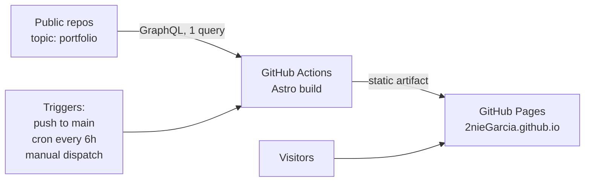

# Portfolio Architecture

Owner: Antonio B. Garcia Jr. ([@2nieGarcia](https://github.com/2nieGarcia))
Last updated: 2026-10-23

## Goal

A static developer portfolio that updates itself from GitHub. There is no backend, database, CMS, or login. Visitors only load prebuilt static files. GitHub is the only content source.

## Overview



At build time, Astro fetches project data from the GitHub GraphQL API and renders static HTML. GitHub Pages serves the result. The build output is the cache: visitors never trigger an API call.

## Content convention (per project repo)

| Item | Required | Purpose |
|---|---|---|
| Topic `portfolio` | Yes | Opt-in flag. Only repos with this topic appear. |
| `docs/summary.md` | Recommended | Frontmatter (`title`, `tagline`, `area`, `stack`, `note`, `order`, `demo`) and a Markdown body. If it is missing, the site uses the repo description and the README's opening paragraphs. |
| `docs/screenshots/*` | No | Images shown on the project page, sorted by filename (`01-…`, `02-…`). The first one is the cover on the home page. Only image files are used (`png`, `jpg`, `jpeg`, `webp`, `gif`, `avif`). Other files in the folder are ignored. |
| Repo website field | No | Used as the live demo link if `demo` is not set in frontmatter. |

`area` is one of `ml`, `gamedev`, `re`, `quant`, `math`, `leadership`, `career`, `web`, `hardware`. `note` is one real highlight shown in the accent color (for example "Built in 24 hours, 4-person team"). Projects with `area: ml` rank first for machine-learning questions in Ask Antonio.

Content that does not live in a repo (leadership, experience, interests) is written in the first person in `src/content/about/*.md`, with the same `area` field. Gallery photos live in `src/assets/gallery/`; the file name is the caption, and the section is hidden while the folder is empty.

Adding the topic is the only step that is required to publish a repo. Removing the topic, or making the repo private, removes it at the next build.

## Data fetch

One GraphQL query per build. Verified on 2026-10-23 against @2nieGarcia: it costs 1 rate-limit point and returns all 26 public repos.

```graphql
query($login: String!) {
  user(login: $login) {
    repositories(privacy: PUBLIC, isFork: false, first: 100, orderBy: {field: PUSHED_AT, direction: DESC}) {
      nodes {
        name url homepageUrl description pushedAt openGraphImageUrl
        repositoryTopics(first: 20) { nodes { topic { name } } }
        summary: object(expression: "HEAD:docs/summary.md") { ... on Blob { text } }
        shots: object(expression: "HEAD:docs/screenshots") { ... on Tree { entries { name } } }
      }
    }
  }
}
```

- The query uses `user.repositories`, not `search`, because the search index can lag behind new repos and topic changes.
- The topic filter runs in the loader, not in the query.
- `first: 100` with no pagination is a deliberate shortcut. Add pagination if the account passes 100 public repos.
- Screenshot URLs: `https://raw.githubusercontent.com/2nieGarcia/<repo>/HEAD/docs/screenshots/<name>`.

## Build

- **Framework:** Astro 7, static output.
- **Data loading:** a custom build-time loader in `src/content.config.ts`. It replaces a separate fetch script and generated files. The loader:
  1. runs the query above with `GH_TOKEN`;
  2. keeps the repos that have the `portfolio` topic;
  3. parses the `docs/summary.md` frontmatter and renders its body;
  4. stores one entry per repo in a `projects` collection.

  `z` is imported from `astro/zod`.
- **Images:** screenshots stay on `raw.githubusercontent.com`. Astro optimizes them at build time through `image.domains: ['raw.githubusercontent.com']` in `astro.config.mjs` and `<Image inferSize>`. The built site serves the optimized copies, not hotlinks. If a repo has no screenshots, the site shows a generated contour cover seeded by the slug (`src/lib/cover.ts`).
- **Pages:**
  - `/` (`src/components/home/Home.tsx`, one React island): TechText name, a pinned word-by-word intro reveal, a pinned sideways project row with the stack marquee, the photo reel, leadership, experience, contact, and Ask Antonio. Projects are sorted by `order`, then by `pushedAt`.
  - `/projects/[slug]`: one page per project, with previous/next links.
  - Both pages share `src/components/home/Chrome.tsx`: the GridScan background, the target cursor, and Lenis smooth scrolling synced with GSAP ScrollTrigger.
- **Look:** coral accent `#ff7a66`, Chakra Petch for display, Barlow for body, Geist Mono for data. Tokens live in `src/layouts/Base.astro`.
- **Third-party components:** `src/components/rb/` holds components copied from React Bits (MIT + Commons Clause; the license is in that folder).
- **Local development:** `GH_TOKEN=$(gh auth token) npm run dev`. To preview repos before they have the topic: `FEATURE_REPOS="Nura=ml,JuryBee=ml"`.

## Embedding index and Ask Antonio

Ask Antonio (bottom-right, or press `/`) looks like a terminal you are breaking into. Its six section buttons jump instantly. Typed questions run a real semantic search over the site's own content in the visitor's browser and jump to the best match. There is no LLM and no server, so it can only return what the site already says.

**Build time** (`src/lib/space.ts`, served as `/space.json` by `src/pages/space.json.ts`):
1. Split every project summary and `about` doc into passages of 1–3 sentences, by heading or paragraph.
2. Embed each passage, prefixed with its project title, with `Xenova/all-MiniLM-L6-v2` (quantized) through `@huggingface/transformers` in Node. Each project also gets an overview passage that names its area ("a machine learning and AI project I built and shipped").
3. Emit `/space.json` (`{ model, passages: [{ id, slug, title, area, href, text, vec }] }`, vectors rounded to 4 decimals).
4. Run the retrieval self-check (`CHECKS` in `src/lib/space.ts`): each question's top result must be one of its expected slugs, or the build fails. Questions whose slugs are not in the index are skipped.

**Ranking** (`src/lib/rank.ts`, shared by the build check and the browser): cosine similarity plus a 0.15 boost for passages whose area matches a keyword intent in the question (ML, hardware, team, …). Acronyms are spelled out first (`src/lib/expand.ts`), because MiniLM embeds "ML" and "RAG" poorly. The UI shows the raw similarity.

**In the browser** (`src/scripts/search.ts`):
1. Opening the panel loads `/space.json` and reports the real record count. The model (about 23 MB) loads on the first typed question, and its real progress lines stream into the log.
2. The question is expanded, embedded with the same model, and ranked against every passage.
3. The best match is shown as a "RECORD FOUND" block with its similarity score (marked low confidence below 0.3), then the page jumps to it.
4. Jumps account for the pinned sections: the intro lands where the reveal is complete, and a project lands with its card in view in the sideways row (`scrollTargetFor` in `Home.tsx`).

**Fallbacks:** without JavaScript, `index.astro` renders a plain list of projects and contact details in `<noscript>`.

## Update triggers

| Trigger | When | Latency |
|---|---|---|
| `push` to `main` | Site code changes | About 1 min |
| `schedule` (`0 */6 * * *`) | Picks up changes in project repos | Up to 6 h |
| `workflow_dispatch` | Manual run: `gh workflow run deploy.yml` | About 1 min |

Every run rebuilds and redeploys. A build takes about 1 minute and Actions minutes are free for public repos, so the workflow does not check for changes before it deploys.

**Inactivity rule:** GitHub disables scheduled workflows in a public repo after 60 days without repository activity. Scheduled runs re-enable the workflow through the API (`gh workflow enable`), using the same method as `liskin/gh-workflow-keepalive`.

## Workflow

`.github/workflows/deploy.yml`, based on the official Astro GitHub Pages workflow:

```yaml
name: Deploy
on:
  push:
    branches: [main]
  schedule:
    - cron: '0 */6 * * *'
  workflow_dispatch:

permissions:
  contents: read
  pages: write
  id-token: write
  actions: write # keepalive: re-enable this workflow

jobs:
  build:
    runs-on: ubuntu-latest
    steps:
      - uses: actions/checkout@v7
      - uses: actions/cache@v6 # MiniLM weights used by the index build
        with:
          path: ~/.cache/huggingface
          key: hf-minilm-l6-v2
      - uses: withastro/action@v6
        env:
          GH_TOKEN: ${{ secrets.PORTFOLIO_TOKEN || secrets.GITHUB_TOKEN }}
      - if: github.event_name == 'schedule'
        run: gh workflow enable deploy.yml --repo ${{ github.repository }}
        env:
          GH_TOKEN: ${{ secrets.GITHUB_TOKEN }}

  deploy:
    needs: build
    runs-on: ubuntu-latest
    environment:
      name: github-pages
      url: ${{ steps.deployment.outputs.page_url }}
    steps:
      - id: deployment
        uses: actions/deploy-pages@v5
```

## Hosting

- **Repo:** `2nieGarcia.github.io`, served at `https://2nieGarcia.github.io`. A user site needs no `base` path. The existing `2nieGarcia` profile README repo is a separate repo and stays unchanged.
- **Pages source:** Settings → Pages → Source: **GitHub Actions**.
- **Custom domain (optional):** add `public/CNAME` and set `site` to the domain.

## Authentication

- **Default token:** the workflow's built-in `GITHUB_TOKEN`. GitHub's docs do not say whether it can read another repo's public data through GraphQL.
- **Fallback:** if the first build fails with a permission error, create a fine-grained PAT. Set resource owner `2nieGarcia`, repository access "Public repositories", and no extra permissions. Save it as the repo secret `PORTFOLIO_TOKEN`. The workflow prefers it automatically.
- **Keepalive step:** always uses `GITHUB_TOKEN`, because a read-only PAT cannot enable workflows.

## Failure modes

| Failure | Result |
|---|---|
| GitHub API down or rate-limited | The build fails. The last good deploy stays live. |
| Malformed `summary.md` frontmatter | The loader logs a warning and skips that repo. The build continues. |
| Screenshot deleted or renamed | It is gone from the site at the next build. Nothing hotlinks to it. |
| Scheduled workflow auto-disabled | Prevented by the keepalive step. If it happens anyway, re-enable it in the Actions tab. |

## Rejected alternatives

| Option | Reason |
|---|---|
| Scraping GitHub HTML | Unstable markup, against GitHub's terms, and it provides nothing the API lacks. |
| `repository_dispatch` from each project repo | Needs a PAT secret and a workflow in every repo, and new repos get forgotten. Breaks zero-maintenance. |
| GitHub App webhook to a serverless function | Real-time updates are not worth an app, a function, and secrets for a portfolio. |
| Vercel | Adds a second vendor for no gain. |
| Committing a fetched data snapshot | Commit churn. A failed build already keeps the last deploy live. |
| GitHub `search` API | The index lags behind topic changes and new repos. |
| Runtime fetching, ISR, or KV cache | Adds runtime code and limits that a static build avoids. |

## Current state (2026-10-23)

- 26 public, non-fork repos. None has the `portfolio` topic or a `docs/summary.md` yet.
- `Nura` and `AI-Powered-Lead-Generation` already have `docs/screenshots/`. Their folders include diagrams and a `README.md`, which the image-extension filter handles.
- To launch, add the topic to the repos to feature and add a `docs/summary.md` where the description is not enough.
